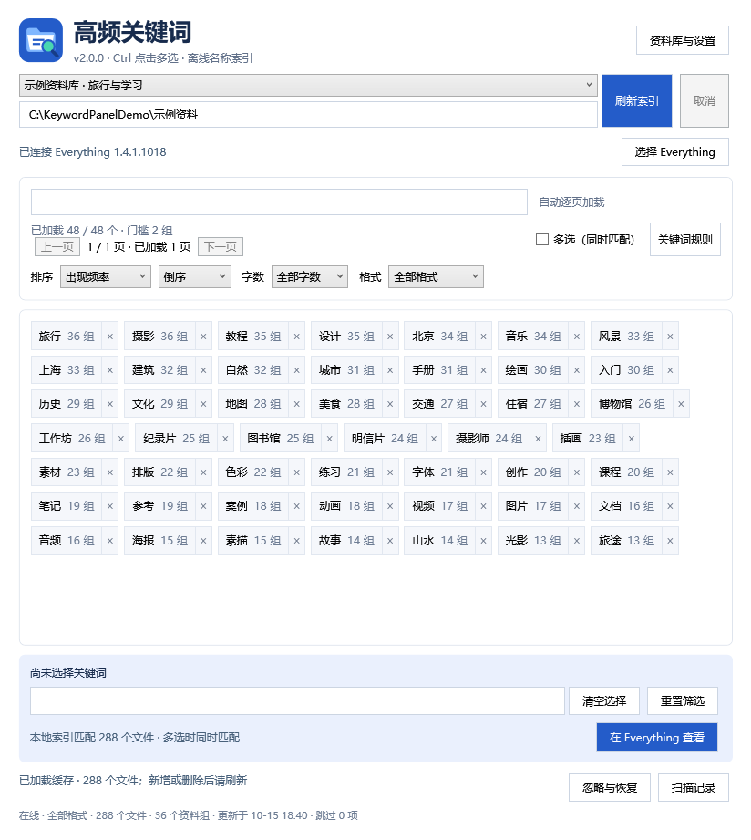
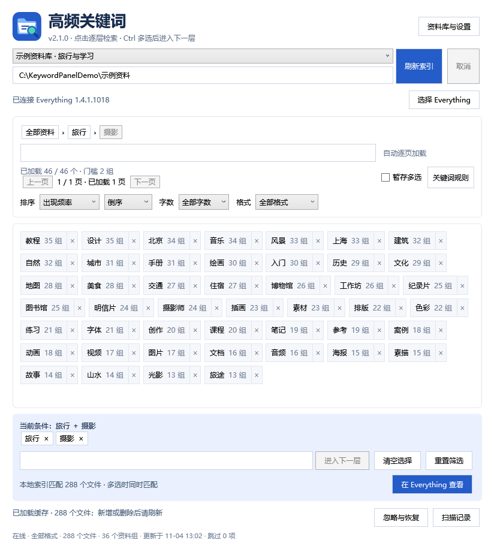

# 高频关键词面板 + Everything

Windows 离线工具，使用 jieba.NET 从用户选定目录的文件名和相对文件夹名归纳高频关键词，交给本机现有 Everything 查看文件。

## 界面预览

以下为真实程序界面，全部使用虚构的示例资料库与样本索引；目录、关键词、文件数量和资料组数量均为演示数据。

关键词排行支持紧凑排列、逐页加载、排序、字数与文件格式筛选；点击词组旁的 × 可直接屏蔽。



多个资料库可以独立保存索引和偏好，设置可导入、导出；分享时默认不包含本机路径。


## 2.2 英文与数字关键词

- 名称索引保留 `2026`、`01`、`high`、`a1` 等独立数字、英文与字母数字组合；`01` 保留前导零。`high_quality` 等复合名称同时保留完整词及有意义的组成部分。
- 在“关键词规则”中关闭“仅显示中文”即可展示混合关键词；可单独关闭“允许纯数字”，纯数字使用“最短位数～最长位数”范围，默认 2～6 位，可在 2～15 位内调整。原有频率、词长、格式与屏蔽规则仍然生效。
- 独立年份可以统计，完整日期、网址、长哈希及停用词继续过滤。同一一级资料组内只计一次，未达到资料组门槛的词仍不会进入排行。
- 首次加载旧缓存时，后台从已存的文件名与相对目录名补算关键词并保存新版名称索引，无需重新读取磁盘文件或正文；后续直接加载升级后的缓存。

## 2.1 逐层关键词检索



- 普通点击一个关键词，进入它对应的文件范围，并重新统计该范围的高频词；支持继续深入多层。
- 顶部路径显示“全部资料 › 旅行 › 摄影”等条件。点击任意上层清除后续条件；下方条件标签的 × 可返回该条件之前，暂存条件的 × 只取消暂存。它们不会屏蔽关键词。
- 同时匹配文件名和相对文件夹名；仅统计匹配文件中的词，同组内只计一次。已进入的词不再出现在下级排行，首页前 100 个词不会限制下级统计范围。
- 首页沿用资料组门槛；下级默认至少 2 组，可在下级“关键词规则”中调整，独立于首页门槛并按资料库保存。
- 进入或返回一层会清空关键词搜索框；格式、字数、排序及屏蔽规则保留。如果当前字数在下级没有匹配，保留筛选并标记“无匹配”，可选“全部字数”放宽。
- Ctrl 多选只暂存当前层的词，不立即改变排行。点击“进入下一层”后按这些词同时匹配；“在 Everything 查看”也会包含当前暂存条件及附加搜索文字。
- 没有更多高频词时保留已匹配文件数量，可返回上层、调整规则或在 Everything 查看。清空选择回到首页；重置筛选也会清除全部层级。

## 使用

1. 解压完整发布包，双击 `KeywordViewer.exe`，或使用桌面“高频关键词面板”快捷方式。
2. 首次扫描后自动显示关键词排行；已有缓存时直接加载。文件新增或删除后点击“刷新索引”。
3. 关键词以紧挨排列的标签按钮展示，按频次从左到右排序并自动换行。普通点击进入下一层，在匹配文件内重新统计关键词；按住 Ctrl 点击或勾选“暂存多选”可先选多个词，再点“进入下一层”，全部条件同时匹配。只有点击“在 Everything 查看”才打开文件结果。
4. 点击“关键词规则”，自行设置至少资料组数、最短/最长词长、仅中文、纯数字开关及最短～最长位数、完全相同的屏蔽词和包含排除片段。每行一个词；保存后立即更新，无需重新扫描。
5. 右键某个关键词可忽略；“忽略与恢复”统一显示手动忽略、× 屏蔽词及包含屏蔽，可多选恢复。“恢复全部”会一并移除默认屏蔽词。频率和词长门槛仍在“关键词规则”中调整。
6. 默认规则为至少 10 个资料组、2～8 字中文词，排除常见宣传词。默认瀑布流滚动逐页加载，每批 100 个，保留上一页、下一页跳转。整页没有选中框，词组自身仍有选中效果。离开视野的页面会回收控件。搜索覆盖全部候选词。
9. 排序支持出现频率、词组名称、词组字数及正序／倒序；字数下拉只列出当前关键词实际存在的字数，随搜索、规则和屏蔽更新，仍保留“全部字数”。排序、字数筛选和窗口大小会保存在本机。
8. 每个关键词旁的“×”可直接将该词添加到屏蔽列表，立即保存；词组主体仍用于搜索。右键关键词也可“添加到屏蔽词”。在“忽略与恢复”中选中并恢复，或在“关键词规则”中删除屏蔽词。
7. 下方“附加搜索文字”可查不在排行中的文字。“在 Everything 查看”发送当前组合，排序、类型筛选和文件打开沿用 Everything。

## 2.0 资料库与格式筛选

- 顶部下拉切换资料库；在“资料库与设置”中新增、改名、更改目录或移除。一库对应一个根目录，屏蔽词、规则、排序、字数、格式及缓存独立保存，记住上次使用的库。
- 旧版本的索引和设置自动迁移为首个资料库，旧文件保留作恢复副本。没有缓存时后台扫描；离线时可浏览已有缓存，恢复连接后刷新。
- 格式下拉仅列实际存在的类别及扩展名。可选视频、图片、音频、文档、压缩包，或具体扩展名。选定格式后词频按相同格式文件重新去重统计，Everything 同步带上格式条件。
- 已选词固定显示，可逐个取消；“重置筛选”清除文字、字数、格式和选词，恢复默认排序，不会清空屏蔽列表。
- 设置可导入／导出，不包含索引；默认省略目录和 Everything 路径。个人备份可勾选包含路径。导入新增资料库，已有库不覆盖；无路径设置需重新选择目录。资料库名称和屏蔽词也可能私密，导出文件不要随意公开。
- 单实例运行：再次启动会激活已有窗口。单独指定 `--data` 时可运行隔离实例用于测试。
- 移除资料库只删除应用缓存和偏好，不删除、改名或移动源目录文件。

扫描根目录名称本身不参与关键词统计。一级文件夹及其所有后代文件算一个资料组；根目录每个独立文件单独算一组。只统计有文件的组，同组内每个词最多计一次。原始高频词库保留至少出现在两个资料组中的词。

词典负责分词，并不预设用户的关键词排行。网址、日期、纯编号、长哈希串、扩展名及通用停用词在分词前后剔除。包含排除作用于提取后的关键词，不会排除或隐藏原文件。

## 本机接入与存储

需要本机安装 Everything，可自动发现或手动选择；从官方 https://www.voidtools.com/ 获取。不捆绑其程序、数据库或设置。

点击词组或“在 Everything 查看”会自动启动 Everything。若原便携启动器需要管理员权限，冷启动时仍需手动确认 Windows 提示；随后复用已解包的主程序传递搜索，不重复运行启动器。启动中连续点击会合并为最后一次选择。不会修改 Everything 或 Windows 权限设置。

每个关键词使用独立的 `path:nocase:nowholeword:noregex:` 搜索修饰符，包含文件夹名称匹配。搜索限制在扫描目录内，使用 `file:` 只展示文件；不改变 Everything 的匹配路径、匹配大小写、正则等设置。不安装服务，不重建 Everything 数据库，不添加其索引目录，也不启用 HTTP/ETP。

面板显示的匹配数来自上次本地扫描；Everything 的实时索引、当前类型筛选或排除范围可能造成数量不同。扫描结束后新增的下载文件需要刷新面板。搜索不存在的组合显示 0 个文件属于正常结果。

索引、忽略列表、规则和运行日志保存于 `%LOCALAPPDATA%\LocalKeywordViewer`。缓存包含本地文件名和路径，属于用户本机数据，不包含在发布包内。程序不读取媒体内容，也不上传名称或文件。扫描跳过文件/目录链接，取消或失败保留上一份完整缓存。

本工具只调用 Everything 的搜索展示，不替代它的文件操作。面板自身不提供删除、移动或重命名功能。

## 构建与检查

需要 .NET 10 SDK。

```powershell
dotnet run --project tests/KeywordViewer.Checks
dotnet run --project tests/KeywordViewer.UiChecks
dotnet publish src/KeywordViewer/KeywordViewer.csproj -c Release -r win-x64 --self-contained true -p:DebugType=None -p:DebugSymbols=false -o release/KeywordPanel
./tools/Check-PublicContent.ps1 -ArtifactDirectory release/KeywordPanel

```

检查程序的新增、删除及长路径测试只在项目 `verification/fixture-*` 目录中进行。公开检查只使用虚构样本。

发布程序支持 `--root <目录>`、`--data <独立缓存目录>`，用于隔离验证；`--scan-report <报告路径>` 使用发布包本身完成后台扫描、缓存和数量报告。

## 开源组件

- [jieba.NET](https://github.com/anderscui/jieba.NET)，0.42.2，MIT；词典及许可随包提供。
- Microsoft .NET 10 / WPF，Microsoft 开源运行环境；自包含发布。
- Newtonsoft.Json 13.0.3，MIT；System.Configuration.ConfigurationManager 10.0.0 为 jieba.NET 配置依赖。
- Everything 属于用户本机现有软件，不捆绑或重新分发。

发布包不包含测试样本、扫描报告、原有 Everything 配置快照及用户索引。

源码采用 [MIT](LICENSE)。开发流程见 [CONTRIBUTING.md](CONTRIBUTING.md)，2.0 需求见 [docs/SPEC.md](docs/SPEC.md)。GitHub Actions 在 Windows 运行样本测试和发布内容检查；Release 提供自包含压缩包及 SHA256。

